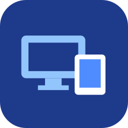

<p align="center">
  
</p>

<h1 align="center">Encaje</h1>

<p align="center">
  <strong>Tu tablet Android como segundo monitor de tu PC con Linux.</strong><br />
  O úsala con el ratón, el teclado y el portapapeles del PC. Para GNOME, KDE Plasma y Niri (Wayland),
  por cable USB o por WiFi, sin root.
</p>

<div align="center">

[![Descargar para Linux][badge-linux]][linux-appimage]
[![Descargar para Android][badge-android]][android-apk]

</div>

<p align="center">
  <a href="https://github.com/sthifen/encaje/releases/latest"></a>
  <a href="https://github.com/sthifen/encaje/releases"></a>
  <a href="https://github.com/sthifen/encaje/stargazers"></a>
</p>


<p align="center">
  <a href="#instalación-sin-compilar">Instalación</a> ·
  <a href="#móvil-por-usb-como-spacedesk">Por USB</a> ·
  <a href="#móvil-o-tablet-por-wifi">Por WiFi</a> ·
  <a href="#sólo-ratón-y-teclado---input-only">Ratón y teclado</a> ·
  <a href="https://github.com/sthifen/encaje/releases/latest">Todas las descargas</a>
</p>

## Cómo funciona

```
Monitor virtual ──► PipeWire ──► H.264 (NVENC / VA-API / OpenH264)
 (GNOME o KDE)        (BGRx)            │
                                        ├─► WebSocket + WebCodecs ── USB (adb reverse)
                                        └─► WebRTC ───────────────── WiFi / LAN
Visor ──(táctil, ratón, teclado)──► WebSocket ──► entrada del escritorio
```

Lo único que cambia entre escritorios está en [`src/backend/`](src/backend):

| Escritorio | Monitor virtual | Entrada | Disposición de pantallas |
|---|---|---|---|
| GNOME | `RecordVirtual` de Mutter (D-Bus) | `org.gnome.Mutter.RemoteDesktop` | Encaje la guarda y la repone |
| KDE Plasma 6 | `zkde_screencast_unstable_v1` de KWin (Wayland) | `org_kde_kwin_fake_input` | KWin la recuerda sola |
| Niri | Conector DRM libre + `RecordMonitor` (D-Bus) | `/dev/uinput` | Encaje la guarda y la aplica con `niri msg` |

En KDE, KWin sólo da esos protocolos a programas con un acceso directo que
los pida (como krfb); Encaje lo crea al arrancar en
`~/.local/share/applications/dev.encaje.kwin.desktop`. El tamaño del
monitor se cambia con `kscreen-doctor`, que viene con Plasma.

En Niri, Encaje enciende un conector DRM libre (`HDMI-A-*` o `DP-*`) en
`/sys/class/drm/card*-*/status`, lo publica por D-Bus (`org.gnome.Mutter.ScreenCast`)
e inyecta la entrada por `/dev/uinput`. Para no necesitar `sudo`, tu usuario debe
pertenecer a los grupos `video` e `input` y tener esta regla en
`/etc/udev/rules.d/99-drm-connector-status.rules`:

```udev
ACTION=="add|change", SUBSYSTEM=="drm", KERNEL=="card[0-9]*-*", RUN+="/bin/sh -c 'chgrp video /sys%p/status && chmod 0664 /sys%p/status'"
```

## Instalación (sin compilar)

Descarga de la [última release](../../releases/latest):

- **`Encaje-x86_64.AppImage`**: un solo archivo.
  `chmod +x Encaje-x86_64.AppImage` y ábrelo con doble clic.
- **`encaje-*-x86_64.tar.gz`**: binario + acceso directo del menú.
  Descomprime y ejecuta `./install.sh` (instala en `~/.local`, sin sudo;
  `./install.sh --uninstall` lo quita).
- **`encaje.apk`**: la app del móvil.

Al abrirlo desde el menú aparece una ventana para elegir el modo: la
tablet como segundo monitor o con el ratón y el teclado del PC. Al cerrarla
se apaga. Desde una terminal (`encaje-launch`) arranca el servidor
directamente, con su registro a la vista. Opciones por defecto (ver
[Opciones](#opciones)) en `~/.config/encaje.conf`, por ejemplo:

```
--fps 60 --bitrate 20000
```

Requisitos: GNOME, KDE Plasma 6 o Niri (experimental) sobre Wayland, con
PipeWire y GStreamer (vienen de serie). Funciona en cualquier distro con glibc 2.34 o más nueva:
Zorin OS 17, Ubuntu 22.04+, Linux Mint 21+, Pop!_OS 22.04, Debian 12,
Fedora, Arch, openSUSE…
Para codificar por hardware hacen falta los plugins de GStreamer de tu GPU:
`nvcodec` (NVIDIA) o `va` (`vah264lpenc` / `vah264enc`, Intel/AMD) en
`gstreamer1-plugins-bad`; si no están, se usa la CPU.

### Si algo falla: informe de error

En la ventana de Encaje, el tercer botón redondo (arriba a la izquierda)
genera un **informe de error**; se pone naranja si el servidor no consigue
arrancar. Desde una terminal:

```bash
encaje --diagnostico      # o: ./Encaje-x86_64.AppImage --diagnostico
```

El informe (`~/.local/state/encaje/informe-*.md`) recoge la distro, el
escritorio y la sesión, las versiones de glibc, GTK, GStreamer y PipeWire,
si el compositor ofrece las APIs que usa Encaje, los codificadores, la GPU,
los móviles conectados y el final del registro
(`~/.local/state/encaje/encaje.log`). Se abre una incidencia en GitHub ya
rellenada: sólo falta contar qué pasó y arrastrar el archivo.

Los paquetes se generan con `packaging/build-dist.sh`.

## Compilar desde el código

```bash
scripts/setup-deps.sh          # una vez: cabeceras de PipeWire sin sudo
cargo build --release
./target/release/encaje --width 2340 --height 1080 --fps 60
```

Aparece un monitor nuevo en *Configuración → Pantallas*; puedes arrastrar
ventanas a él. Al cerrar el programa (Ctrl+C) desaparece.

### Móvil por USB (como Spacedesk)

1. Activa *Opciones de desarrollador → Depuración USB* y conecta el cable.
2. Instala la app: `android/build-apk.sh --install` (o copia
   `android/encaje.apk` al móvil).
3. Abre **Encaje**: detecta el PC sola y entra a pantalla completa.

El servidor ejecuta `adb reverse tcp:8787 tcp:8787` en cada móvil conectado
(y lo repite si el móvil se reconecta). Por USB se usa WebSocket +
WebCodecs, porque `adb reverse` sólo reenvía TCP.

**Si va lento por USB, revisa el cable.** Con un cable de mala calidad
(o sólo de carga a medias) el móvil negocia USB 1.1 a 12 Mbit/s en lugar de
480 Mbit/s. Compruébalo con:

```bash
cat /sys/bus/usb/devices/*/speed  # junto al dispositivo SAMSUNG_Android, etc.
lsusb -t                          # el móvil debería aparecer con 480M
```

Aun así el servidor se adapta: el visor confirma cada frame, el servidor
mide el retraso real y baja el bitrate antes de que se acumule (con un
enlace simulado de 7 Mbit/s el retraso de cola pasa de ~3 s a ~11 ms).

### Móvil o tablet por WiFi

En la app, escribe la IP del PC en el recuadro *WiFi*, o abre
`http://IP-DEL-PC:8787` en cualquier navegador. Se usa WebRTC.

### Sólo ratón y teclado (`--input-only`)

La tablet sigue mostrando **su propio Android** y no se transmite nada de
pantalla: el monitor virtual sólo sirve para que el escritorio sepa dónde está.
Al mover el ratón hacia él, aparece el puntero de Android en la tablet;
al volver, el ratón regresa al PC. Como Barrier o Deskflow, pero sin
instalar nada en la tablet.

```bash
./target/release/encaje --input-only    # o --solo-entrada
```

1. Conecta la tablet por USB con la *Depuración USB* activada.
2. En *Configuración → Pantallas*, coloca el monitor nuevo donde está la
   tablet (a la derecha, encima…).
3. Para escribir en la tablet, **haz un clic en ella**: el teclado va
   donde hiciste el último clic, igual que con cualquier ventana.

Cómo funciona: por adb se lanza en la tablet un pequeño servidor
(`android/server`, con permisos de *shell*, sin root ni app) que crea un
ratón y un teclado HID virtuales. Android los trata como periféricos
reales, así que dibuja su puntero y entiende atajos y teclas especiales.
Android 16 ignora los ratones HID absolutos, así que el ratón es relativo:
mientras dura la sesión se desactiva la aceleración del puntero (y se
restaura al salir), y el PC lleva la cuenta de dónde está el puntero.

**Portapapeles compartido.** Lo que copies en el PC (texto o imágenes) se
puede pegar en la tablet, y al revés. En el PC se usa el portapapeles de
X11, que Mutter mantiene sincronizado con el de Wayland; en la tablet, el
servidor usa el portapapeles de Android con los permisos de *shell*. Para
pegar en la tablet una **imagen** copiada en el PC hace falta la app
instalada: Android sólo guarda imágenes como URI `content://`, y es la app
(`ClipProvider`) la que la sirve. El texto funciona sin ella.

- El monitor virtual mide lo mismo que la tablet en "unidades de ratón",
  así que el puntero va a la misma velocidad que un ratón conectado a ella.
  Al girar la tablet, el monitor cambia de forma.
- La distribución del teclado la decide Android: si tu teclado no es
  inglés, elígela una vez en la tablet en *Ajustes → Administración
  general → Teclado físico → Encaje Keyboard*.
- GNOME se queda algunos atajos (la tecla Super, Alt+Tab).
- Con varios dispositivos conectados, elige uno con `ANDROID_SERIAL=…`.

## Resolución y rendimiento

La resolución del monitor virtual **se adapta a la pantalla que se conecta**:
el visor envía su tamaño en píxeles físicos y su orientación, y Mutter cambia
el modo del monitor en caliente (al girar una tablet también). Así cada
dispositivo recibe su proporción exacta, sin bandas negras.

En el menú del visor (⋮ → *Resolución*):

| Opción | Píxeles (móvil 2340×1080) | |
|---|---|---|
| Nativa | 2340×1080 | Máxima nitidez |
| 75 % | 1755×810 | ~56 % de los píxeles |
| 50 % | 1170×540 | ~25 % de los píxeles; ideal para enlaces lentos |
| Otra… | la que escribas | p. ej. `1600x900` |

Bajar la escala reduce el trabajo en **todas** las etapas (GNOME dibuja menos,
la GPU codifica menos y viaja menos por USB/WiFi); la imagen se estira a
pantalla completa, y los textos y ventanas se ven más grandes. La elección se
guarda en cada dispositivo. Si se conectan varios a la vez, manda el último.

## Opciones

| Opción | Por defecto | |
|---|---|---|
| `--width`, `--height` | automática | Fija la resolución e ignora la de los visores. |
| `--fps` | automática | Fija los fotogramas por segundo. Sin ella se usa la frecuencia de la pantalla del visor (60, 90, 120 Hz…), y baja sola si su decodificador no da abasto. |
| `--max-fps` | 120 | Máximo cuando la frecuencia es automática. |
| `--bitrate` | 12000 | kbit/s. |
| `--encoder` | `auto` | `nvenc`, `vaapi`, `openh264`. `auto` prueba el hardware y usa la CPU si falla. |
| `--port` | 8787 | Puerto HTTP. |
| `--no-usb` | | No ejecutar `adb reverse`. |
| `--input-only` | | Sólo ratón y teclado; ver [arriba](#sólo-ratón-y-teclado---input-only). |
| `--diagnostico` | | Informe para reportar un fallo; ver [arriba](#si-algo-falla-informe-de-error). |

`RUST_LOG=debug` muestra más detalle. Cada 5 s se registran los fps de
captura y envío, el coste de codificar y la edad del frame, y lo que mide el
visor: cuánto tarda en decodificar y dibujar, la cola del decodificador y las
resincronizaciones (también en el menú ⋮ del visor).

### Fluidez en tablets modestas: el visor nativo

La app de Android trae su propio visor (`NativeViewerActivity`): recibe el
mismo flujo que el visor web, lo decodifica con **MediaCodec en modo de baja
latencia** (`KEY_LOW_LATENCY` y las claves de cada fabricante) y lo dibuja
**directamente en la pantalla**, sin WebView, sin canvas y sin JavaScript de
por medio. Es el que se abre por defecto; en el lanzador se puede desmarcar
*Visor nativo* para usar el del navegador, y en su menú ⋮ hay *Usar el visor
web*, *Teclado*, la resolución y las estadísticas.

El visor mide la frecuencia de su pantalla y el PC transmite a ese ritmo; la
app pide además el modo de pantalla con más hercios (muchas tablets dejan
las apps a 60 Hz si no). Si el decodificador no da abasto (hace cola o tarda
más de dos frames en devolver cada uno), se pide la siguiente frecuencia más
baja (90 → 75 → 60…) y, pasado un minuto, se vuelve a probar.

Medido en una Lenovo Tab M11 (MediaTek MT8786, pantalla de 90 Hz, por USB):

| Visor | Resolución | fps | Retraso al decodificar | Cola | Resincronizaciones |
|---|---|---|---|---|---|
| Web, 90 fps forzados | 960×600 | ~81 | 110–135 ms | 14–15 frames | 4–5 cada 5 s |
| Web, automático | 960×600 | 60 | ~14,5 ms | 0 | 0 |
| **Nativo, automático** | **1920×1200** | **89,4** | **~14,7 ms** | **1** | **0** |

Además el servidor desactiva Nagle (`TCP_NODELAY`) en todas las conexiones,
agrupa las peticiones de keyframe (como mucho una cada 250 ms, aunque entren
y salgan visores sin parar) y añade al SPS de NVENC `max_num_reorder_frames
= 0`, para que los decodificadores que lo respetan no retengan frames.

## Rendimiento medido (2340×1080, GTX 1650 + i7 Alder Lake)

| Codificador | Coste por frame | fps enviados |
|---|---|---|
| NVENC | ~1.5 ms (asíncrono) + ~1.5 ms de copia | ≈ los capturados (~50) |
| OpenH264 (CPU) | 30–80 ms | 10–20 |

OpenH264 sólo es razonable hasta ~1280×720.

A 2340×1080 y 90 fps con NVENC: 89,3 fps enviados, ~7–8 ms desde que llega
el frame hasta tenerlo codificado, intervalo entre frames 11,3 ms de mediana
y 14,4 ms en el p99.

## Pruebas

```bash
cargo test
# Estrés sin escritorio: imagen sintética + visores, visores lentos,
# reconexiones sin parar e inundación de entrada (con basura); falla si el
# servidor muere, crece la memoria o los hilos.
tests/stress/run-local.sh target/release/encaje 60 --fps 90 --width 2340 --height 1080
# El binario de los paquetes (compilado en Ubuntu 22.04) en Ubuntu 22.04 y
# 24.04, Debian 12, Fedora, Arch y openSUSE, con podman o docker:
packaging/compat/build.sh && tests/distros/run.sh 30
```

## Estructura

| Ruta | |
|---|---|
| `src/backend/mod.rs` | Detección del escritorio e interfaz común `VirtualDisplay`. |
| `src/backend/gnome.rs` | GNOME: monitor virtual y entrada (D-Bus a Mutter). |
| `src/backend/mutter_layout.rs` | GNOME: disposición de monitores (`DisplayConfig`). |
| `src/backend/kde.rs` | KDE Plasma: monitor virtual y entrada (protocolos Wayland de KWin). |
| `src/backend/niri.rs` | Niri: activación de conector DRM, screencast PipeWire y entrada por `/dev/uinput`. |
| `src/backend/layout.rs` | Común: pantalla vecina y posición guardada de la tablet. |
| `src/capture.rs` | Consumidor PipeWire; deja sólo el frame más reciente. |
| `src/encoder.rs` | Backends H.264, keyframes bajo demanda, estadísticas. |
| `src/h264.rs` | Reescribe el SPS para que el decodificador no retenga frames. |
| `src/diagnose.rs` | Registro en `~/.local/state/encaje/` e informe de error. |
| `packaging/compat/` | Contenedor de compilación (Ubuntu 22.04) para los paquetes. |
| `tests/` | Pruebas de estrés y de distros. |
| `src/server.rs` | HTTP (axum): visor, `/offer` WebRTC, `/ws/video`, `/ws/input`. |
| `src/rtc_peer.rs` | Un `PeerConnection` (webrtc-rs) por visor, sin trickle ICE. |
| `src/adb.rs` | Modo USB (`adb reverse` automático). |
| `src/input_only.rs` | Modo `--input-only`: servidor en la tablet y posición del puntero. |
| `src/grab_window.rs` | Ventana invisible sobre el monitor virtual que recoge ratón y teclado. |
| `src/clipboard.rs` | Portapapeles del PC (X11 + XFixes) para el modo `--input-only`. |
| `android/server/` | Servidor UHID y de portapapeles para la tablet; `android/build-apk.sh` genera `input-server.jar`. |
| `web/index.html` | Visor (incrustado en el binario). |
| `android/` | App: lanzador USB/WiFi, visor nativo (MediaCodec) y visor web (WebView). Se compila sin Gradle. |

## Limitaciones

- Sólo GNOME, KDE Plasma y Niri sobre Wayland. Para Hyprland/Sway (wlroots) o
  X11 (Cinnamon, XFCE) haría falta otro backend en `src/backend/`.
- KDE: probado con un KWin 6.7 de prueba (sin pantalla), aún no en una
  sesión de Plasma con la tablet.
- Sin audio.
- WebRTC no reacciona a los PLI del navegador; se recupera con el IDR
  periódico (cada 2 s).

## Material promocional

Imágenes para redes (banner, posts, historias) y video en
[`promo/out/`](promo/out); los videos MP4 están en las
[releases](../../releases/latest). Se regeneran con `python3 promo/gen.py`
(necesita ImageMagick con librsvg y ffmpeg).

[badge-linux]: https://img.shields.io/badge/Linux-AppImage-1E3A8A?style=for-the-badge&logo=linux&logoColor=white
[badge-android]: https://img.shields.io/badge/Android-APK-3DDC84?style=for-the-badge&logo=android&logoColor=white
[linux-appimage]: https://github.com/sthifen/encaje/releases/latest/download/Encaje-x86_64.AppImage
[android-apk]: https://github.com/sthifen/encaje/releases/latest/download/encaje.apk
